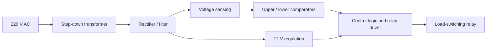

# Over/Under Voltage Protection Device

**Electrical & Electronics Engineering · Graduation Project**  
**Proteus simulation · Circuit design · PCB layout · Manufacturing · Custom enclosure**

An adjustable voltage-protection circuit designed to disconnect a connected load when the AC supply falls outside a selected operating range.

> **Project status:** Simulated protection behavior and a manufactured, populated PCB in a custom enclosure are documented. Full powered protection testing of the finished physical device is **not established by the supplied report**.

## Project overview

This project progressed from theoretical analysis and circuit design to schematic simulation, PCB layout, fabrication, soldering, checks, and enclosure design.

| Parameter | Design / reported value |
| --- | --- |
| Nominal AC input | 220 V, 50 Hz |
| Transformer | 220 V AC → 24 V AC |
| Control supply | 12 V DC, 7812 regulator |
| Normal operating window used in simulation | Approximately 200–240 V AC |
| Detection | Upper- and lower-limit comparator stages |
| Output control | Logic, driver and relay / contactor |
| Adjustment | Potentiometers controlling thresholds |
| Design software | Proteus / Proteus ARES |
| Enclosure software | Shapr3D |
| PCB manufacturing | Toner transfer + chemical etching; later CNC machining/drilling |

## Functional architecture

*Functional block diagram only; use the native schematic to verify circuit-level connections.*

## Engineering workflow

1. **Analysis and schematic:** Selected components, calculated circuit parameters and designed the protection circuit.
2. **Simulation:** Evaluated the power supply and load switching under normal, low and high input voltage in Proteus.
3. **PCB design:** Placed components and routed the board in Proteus ARES, including a custom potentiometer footprint.
4. **Manufacturing iteration:** Attempted toner-transfer / chemical etching; improved board fabrication with CNC tooling after trace and drilling problems.
5. **Assembly:** Populated and soldered the board, checked component orientation, continuity and shorts.
6. **Enclosure:** Designed an enclosure with separate space for the PCB and transformer in Shapr3D.

## Example results from the report

| Simulated input | Reported load state |
| --- | --- |
| 195 V | OFF (undervoltage) |
| 200 V | ON |
| 220 V | ON |
| 240 V | ON |
| 245 V | OFF (overvoltage) |

These examples are **reported simulation/test-table results, not verified physical prototype trip measurements**. The report uses slightly differing threshold descriptions, so a hardware-calibrated threshold is not claimed. See [verification notes](docs/verification.md).

## Technical documentation

- [System design and components](docs/system-design.md)
- [PCB design and fabrication](docs/pcb-and-manufacturing.md)
- [Simulation and verification](docs/verification.md)
- [Enclosure design](docs/enclosure.md)
- [Team attribution and contributions](docs/contributions.md)
- [Original project files checklist](docs/source-files.md)

## Gallery and native source files

Screenshots of the actual schematic, PCB, prototype and enclosure will be added from the owner's original project files when available. Native Proteus / ARES, Gerber and Shapr3D files are not yet included.

## Notion portfolio

A visual project case study is also being built in Notion; link to be added.

## Safety

Academic proof-of-concept only. **Not a certified mains protection device.** Live electrical use requires suitable insulation, protective devices, enclosure design and supervised verification.

---

*Based on the supplied university graduation project report. The report describes a group project; see [attribution](docs/contributions.md) for accurate credit.*
