# Project Image Gallery

This gallery contains selected original project screenshots and photographs supplied by the project owner. Images are organized in the order of the engineering development workflow. They have been optimized for browsing; the original full-resolution images remain with the project owner.

## 1. Physical prototype

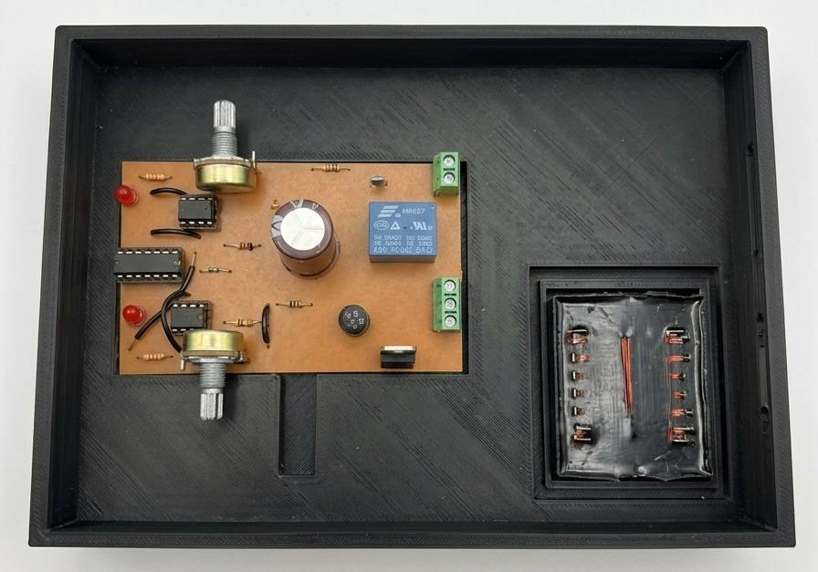

*Figure 1 — Physical PCB and transformer positioned inside the custom enclosure. This is an assembly photograph, not proof of final electrical certification.*

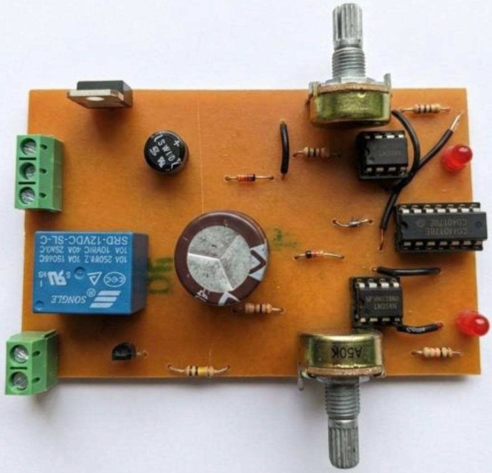

*Figure 2 — Fabricated PCB populated with relay, electrolytic capacitor, ICs, adjustable potentiometers, and other components.*

## 2. Circuit and schematic design

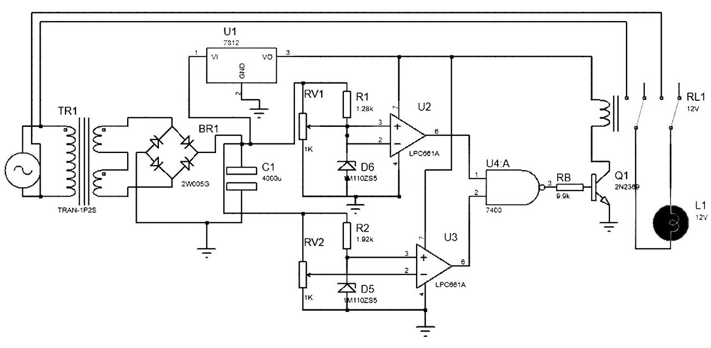

*Figure 3 — Complete overvoltage and undervoltage protection circuit schematic.*

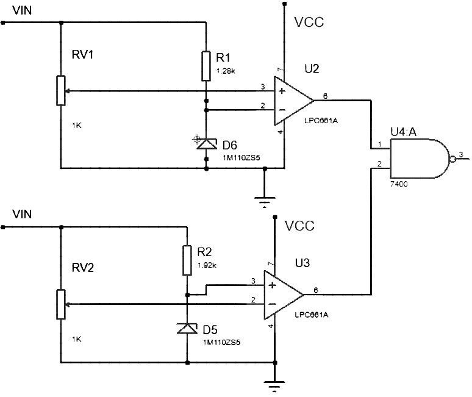

*Figure 4 — Voltage reference and comparator stages used to detect upper and lower operating limits.*

## 3. PCB design

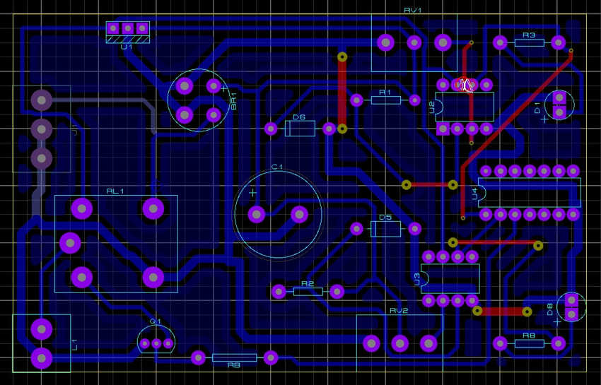

*Figure 5 — Routed PCB layout prepared in Proteus ARES.*

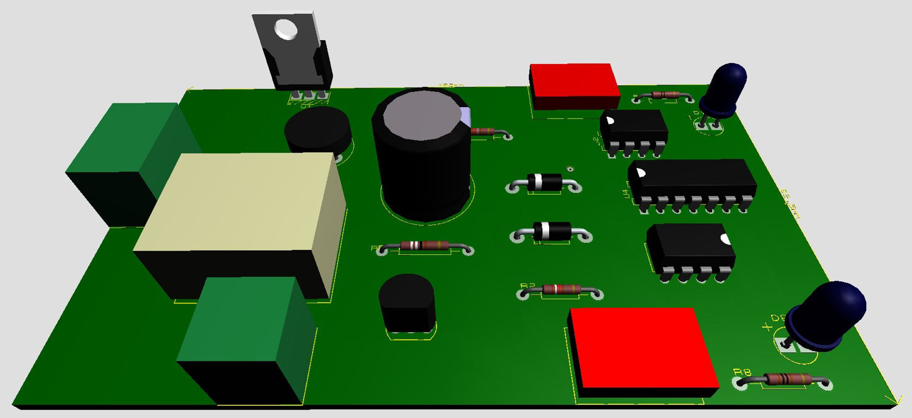

*Figure 6 — Three-dimensional visualization of the PCB component placement.*

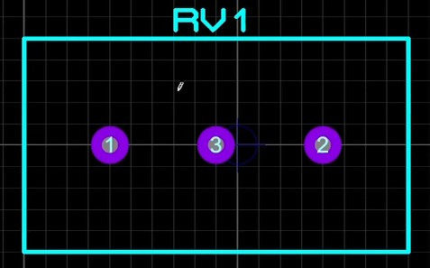

*Figure 7 — Custom PCB footprint for the potentiometer, created to fit the actual component dimensions.*

## 4. Fabrication and manufacturing improvement

| Chemical-etched board | CNC-fabricated board |
| --- | --- |
| 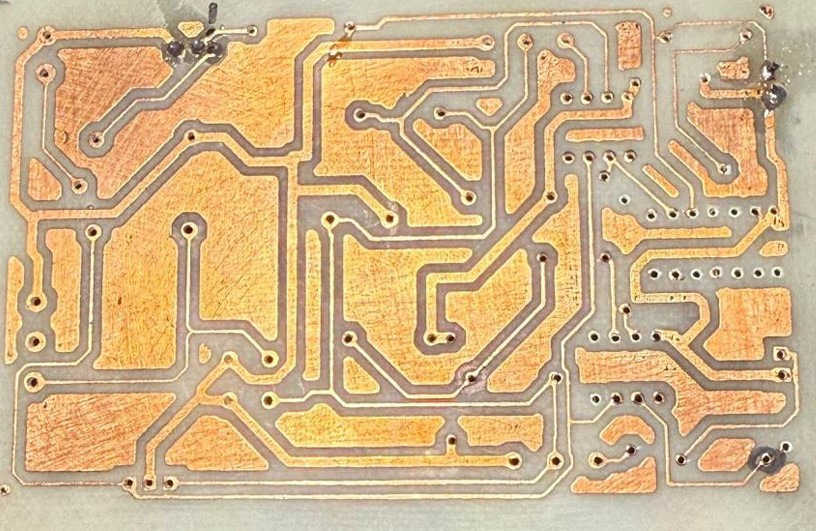 | 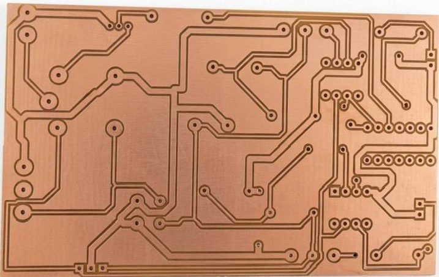 |

*Figures 8–9 — Initial chemical-etching result and subsequent CNC-manufactured board. The later method addressed trace quality and drilling alignment issues described in the report.*

## 5. Enclosure

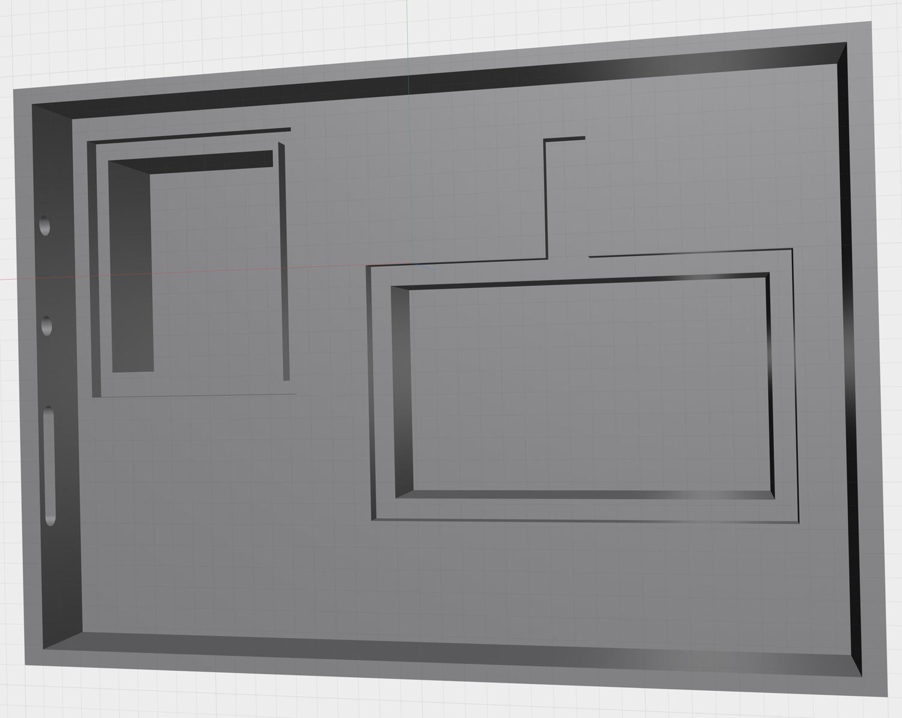

*Figure 10 — Custom enclosure modeled in Shapr3D, with separate placement regions for the PCB and transformer.*

## 6. Proteus simulation

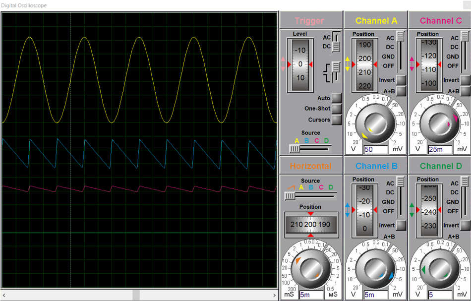

*Figure 11 — Simulated AC-to-DC supply waveforms displayed in the Proteus virtual oscilloscope.*

| Normal voltage | Undervoltage | Overvoltage |
| --- | --- | --- |
| 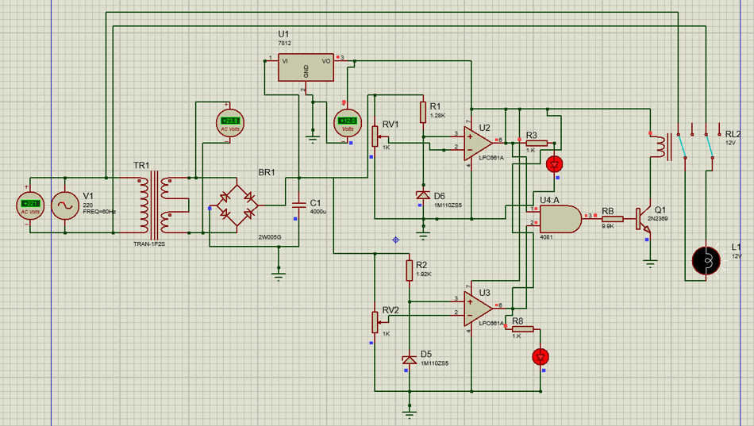 | 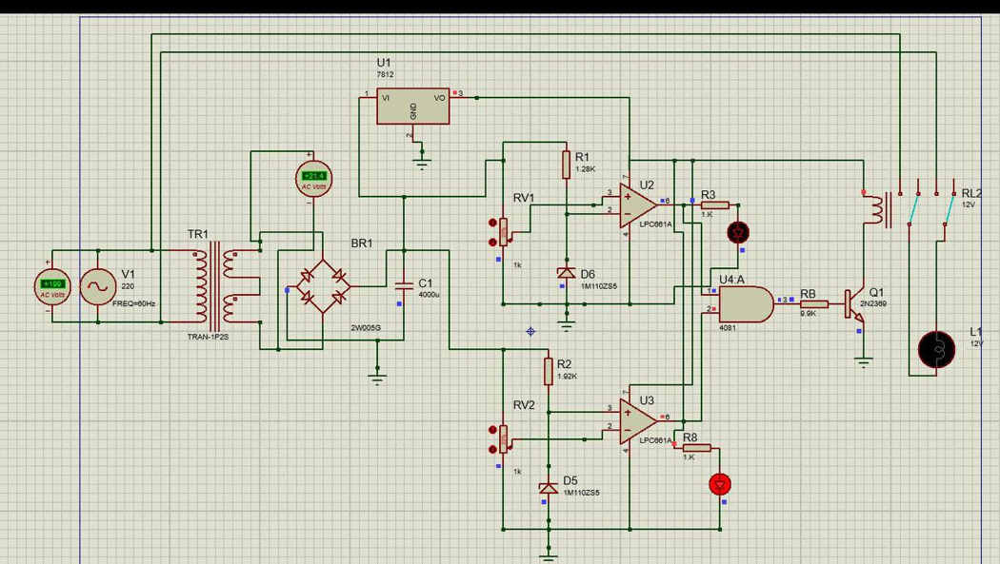 | 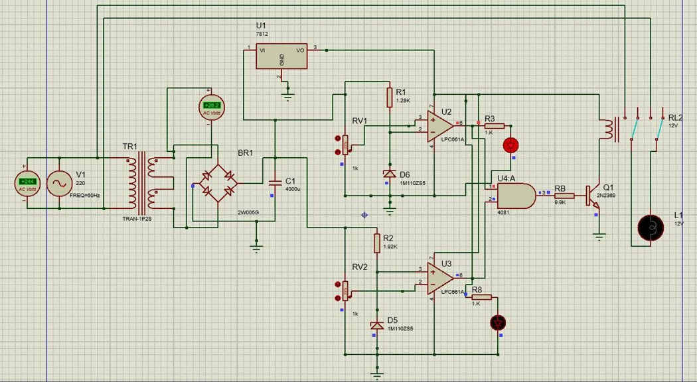 |

*Figures 12–14 — Proteus simulation states for nominal, low, and high input voltages. These screenshots do not establish measurements of the finished physical prototype.*

## Design sources

See the [native Proteus project](../over.and.under.voltage.device.pdsprj) for the editable circuit design and PCB layout, and the [main README](../README.md) for the project overview.

*Educational engineering project — not a certified mains-voltage protection product.*
