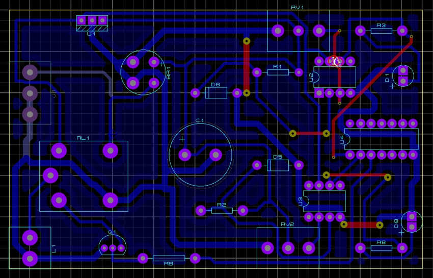
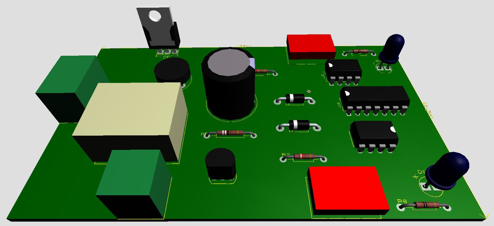
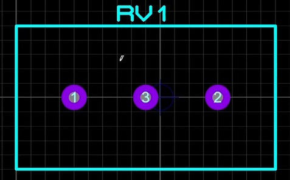
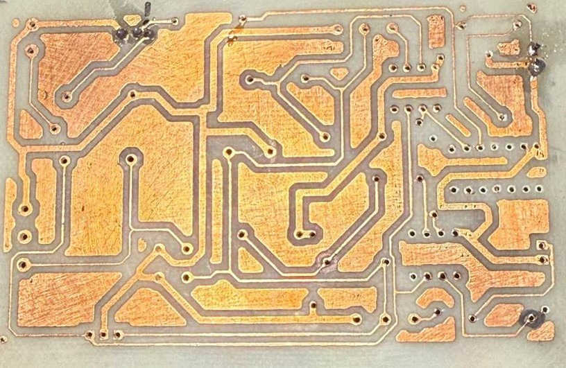
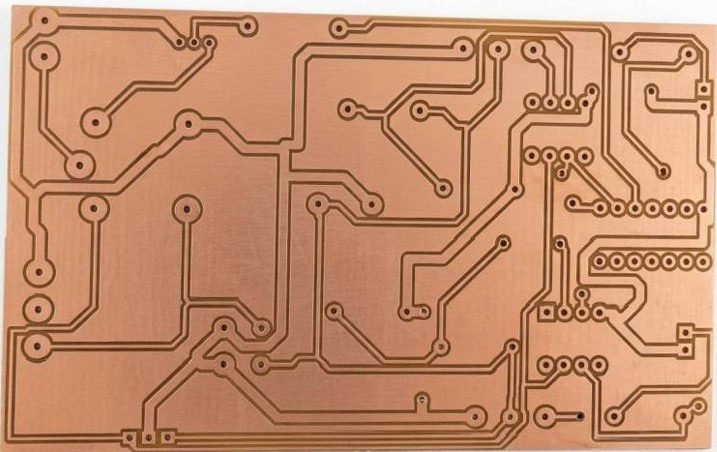
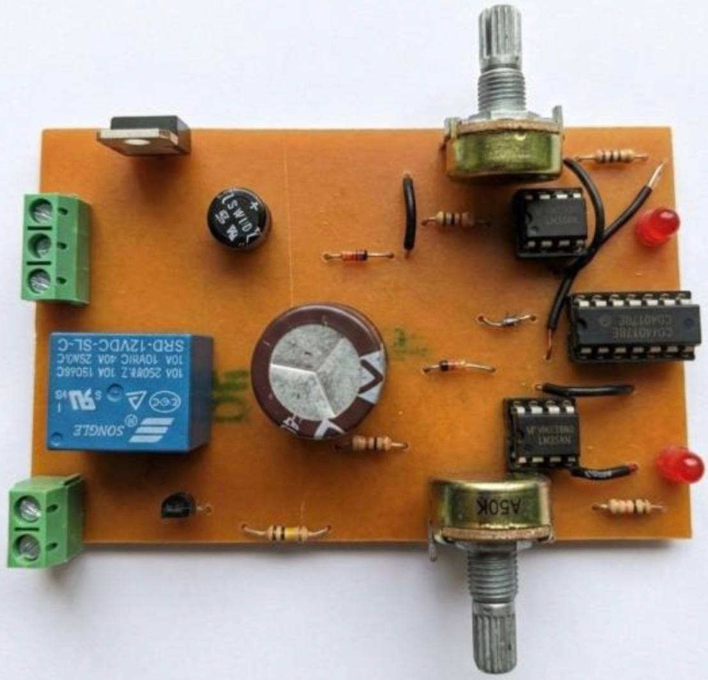

# PCB design, manufacturing, and assembly

## Visual evidence

| PCB routing | PCB 3D model |
| --- | --- |
|  |  |

*Custom footprint developed for the project's potentiometer.*

| Chemical-etched board | CNC-manufactured board |
| --- | --- |
|  |  |

*PCB populated and soldered after fabrication.*

## PCB layout

The original circuit was transferred to Proteus ARES for PCB design. The report describes component placement, track routing, grounding considerations and separating power-related elements from sensitive control stages.

One notable engineering task was **designing a custom potentiometer footprint** after an appropriate library package was not found. The team used physical measurements to establish component dimensions.

## Manufacturing: iteration 1

The first fabrication attempt used toner transfer to copper-clad board followed by ferric chloride (FeCl₃) etching. The report identifies incomplete fine traces and inaccurate manual hole positions as practical challenges.

## Manufacturing: iteration 2

The PCB was subsequently recreated using CNC-assisted machining and drilling. Trace quality and hole placement improved compared with the manual process.

## Assembly and checks

Electronic components were soldered onto the manufactured PCB. The report describes orientation and polarity checks, visual inspection of joints, multimeter continuity measurements, and checks for power-to-ground shorts.

## Images to add

- PCB routing layout
- PCB 3D visualization
- Custom potentiometer footprint
- Chemically etched PCB
- CNC-produced PCB
- Finished populated board

## Original files to add

- Proteus ARES PCB project
- Gerber / CNC manufacturing outputs
- Original fabrication images

*Based on the graduation project report's PCB design, PCB production and assembly sections.*
