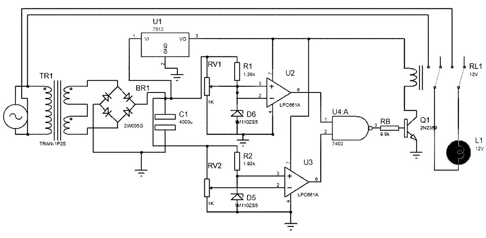
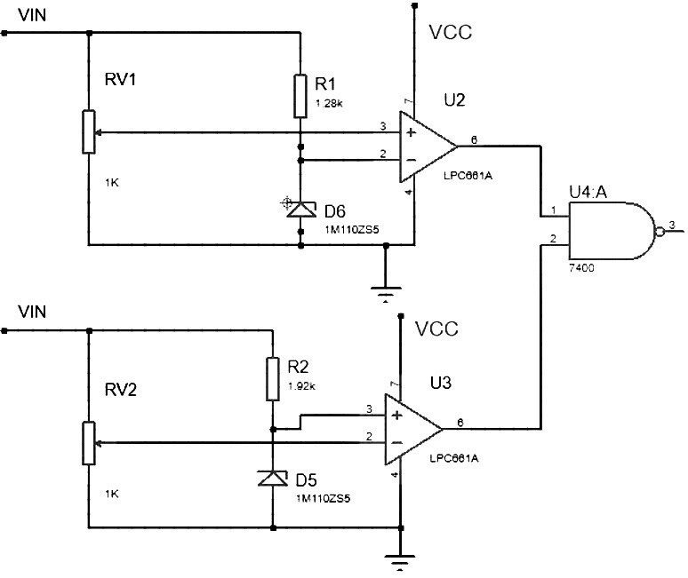

# System design and components

## Purpose

The project monitors an AC supply and controls a relay-operated load based on adjustable upper and lower voltage limits.

## Original circuit illustrations

*Full voltage protection schematic supplied with the project.*

*Voltage sensing and comparison portion of the design.*

## Circuit stages

1. **Transformer:** steps nominal 220 V AC down to 24 V AC.
2. **Rectifier/filter:** bridge rectifier and filter capacitor create a smoother DC supply.
3. **Regulation:** a 7812 provides nominal 12 V DC to the control circuitry.
4. **Reference network:** Zener diodes and potentiometers establish adjustable threshold levels.
5. **Comparator stages:** compare sensed voltage against reference levels.
6. **Logic and relay driver:** use comparator outputs to control load disconnection.

## Technical details

| Stage | Reported components / parameters |
| --- | --- |
| AC input | 220 V AC, 50 Hz |
| Transformer secondary | 24 V AC |
| Voltage regulator | 7812, 12 V output |
| Comparator references | Zener diodes |
| Threshold adjustment | Two potentiometers |
| Switching | Logic control, transistor / driver, relay |

The report's conceptual block diagram describes an AND gate, while some subsequent simulation text uses NAND terminology. The exact implemented logic should therefore be verified against the original Proteus project before making component-level wiring claims.

## Design materials needed

- Original Proteus schematic/project file
- Full-resolution schematic image or PDF
- Component list or BOM (if available)
- Any calculation spreadsheets

*Based on the graduation project report's system design, component selection, and schematic sections.*
