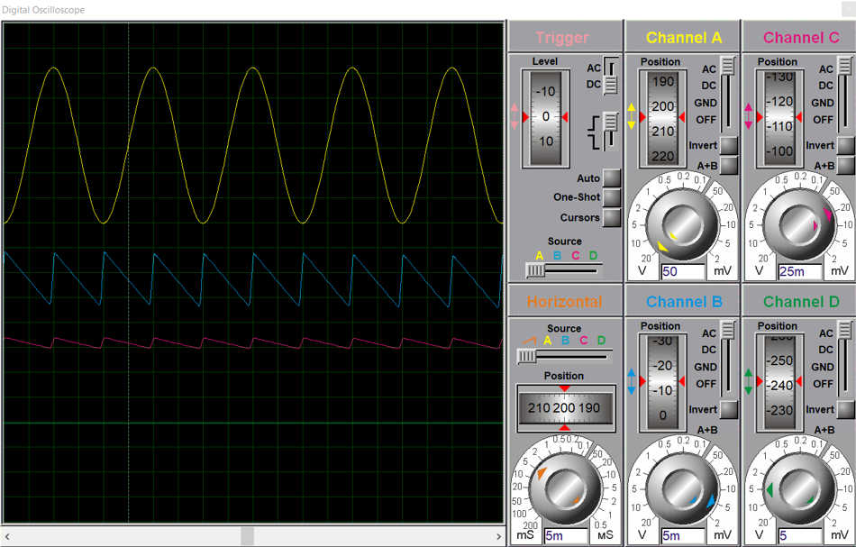
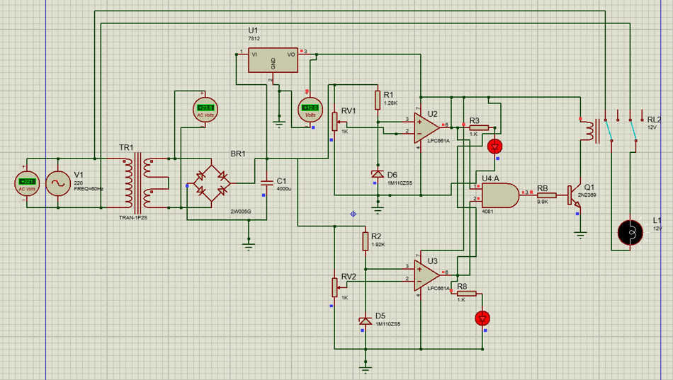
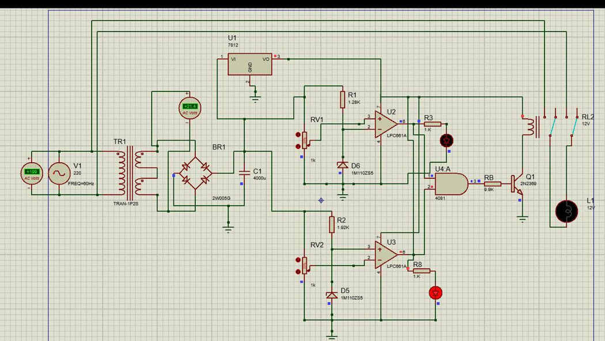
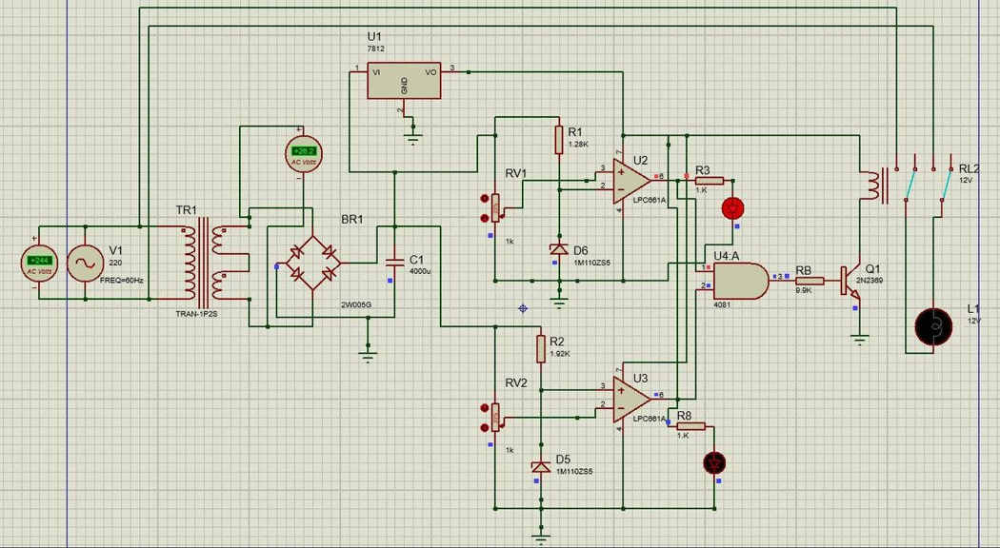

# Simulation, testing, and verification status

## Screenshots from Proteus

*Proteus simulated power supply waveform display — not a physical laboratory oscilloscope reading.*

| Normal voltage | Undervoltage | Overvoltage |
| --- | --- | --- |
|  |  |  |

## Reported simulation / result-table values

The university report records the following cases:

| Supply input (V AC) | Reported contactor / load state |
| ---: | :---: |
| 100 | OFF |
| 180 | OFF |
| 195 | OFF |
| 200 | ON |
| 205 | ON |
| 215 | ON |
| 220 | ON |
| 230 | ON |
| 240 | ON |
| 245 | OFF |
| 255 | OFF |
| 265 | OFF |
| 275 | OFF |
| 300 | OFF |

**Source:** The report's simulation results section, including its results table. These are not newly collected physical hardware measurements.

The report describes **200–240 V** as a simulated normal window, while another paragraph discusses switching around **198–243 V**. Until validated against native simulation files or calibrated physical tests, exact hardware trip thresholds should not be asserted.

## Documented physical prototype checks

- Inspection of solder joints, pin connections and polarity
- Multimeter continuity checks
- Checks for shorts between VCC / GND
- Pre-power-on visual review

## Not established by the supplied report

- Complete measured mains-level switching tests on the finished device
- Trip/reconnect accuracy and repeatability
- Transient response and endurance characterization
- Electrical isolation, thermal and regulatory safety qualification

## Evidence that could be added later

| Condition | Measurement to record | Evidence |
| --- | --- | --- |
| Normal input | Actual applied voltage and relay state | Test photo/video |
| Undervoltage | Measured disconnect and reconnect points | Test log |
| Overvoltage | Measured disconnect and reconnect points | Test log |
| Restoration | Measured operation and timing | Test log |

**Safety:** This is an educational prototype, not a certified protection device. Any live mains testing requires suitable isolation, safety controls and qualified oversight.
